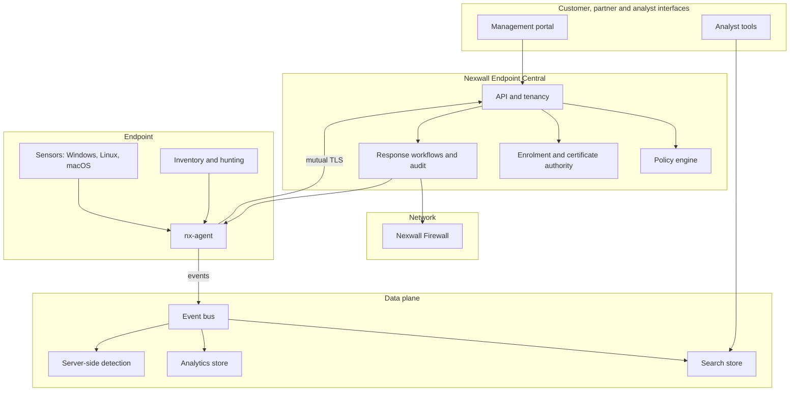
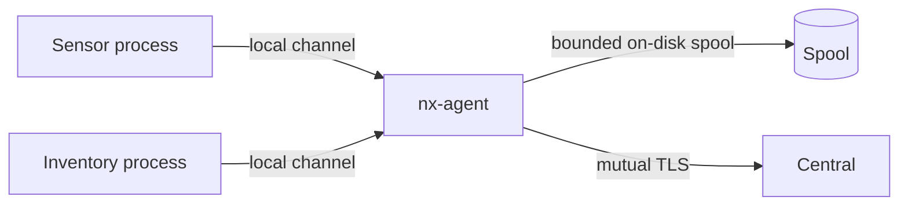
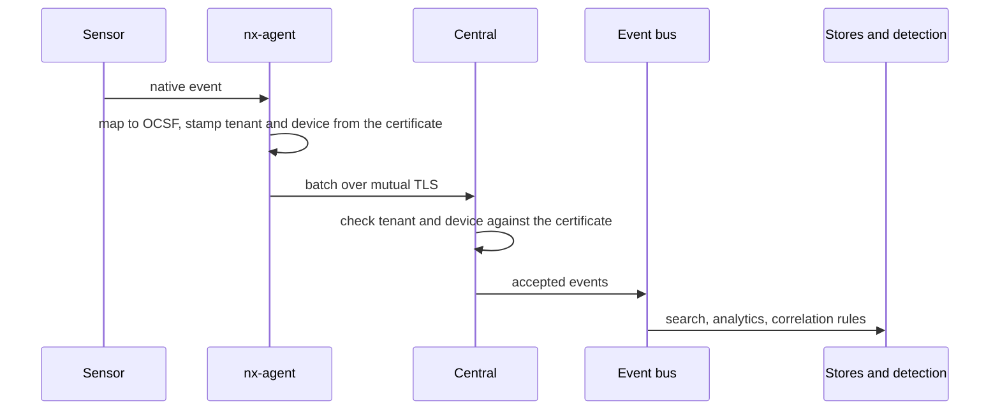

# Architecture

Nexwall Endpoint is a composed platform with a thin owned core. The layers below show where each part lives.

## Process model on the endpoint

`nx-agent` is the only component that talks to the central service. Sensors run as separate processes and talk to the agent over a local channel (a Unix domain socket on Linux and macOS, a named pipe on Windows).

- A sensor never opens its own connection to the internet.
- A sensor crash never stops the agent. The agent restarts it with exponential backoff and reports its health.
- Sensors, rules and the agent update independently.

## Agent responsibilities

1. **Enrol** with a single-use token and receive a client certificate bound to one tenant and one device.
2. **Policy**: pull signed policy, verify it, apply it, report compliance, keep the last known good copy and roll back if health fails.
3. **Update**: staged rings (canary, early, general) with deterministic assignment, signed manifests, rollback and a central stop switch.
4. **Spool**: a bounded on-disk queue while offline, with a documented drop policy. It is never unbounded.
5. **Health**: heartbeat with sensor states, versions, resource use, policy hash and tamper flags.
6. **Tamper resistance** in user mode: service permissions, file and registry guards, watchdog, signed binaries.
7. **Response executor**: carries out actions requested by Central. Actions are authorised, idempotent and audited on the device and centrally.

## Main flows

- **Detection** runs in two places: rules on the endpoint for low latency, and correlation rules in the central service. Every alert keeps the rule's author and source.
- **Response** starts from an analyst or an automated recommendation, passes an approval step defined by policy, runs through the agent and, where useful, the firewall, then verifies the new state and writes an audit record. See [Response and firewall](response-and-firewall.md).
