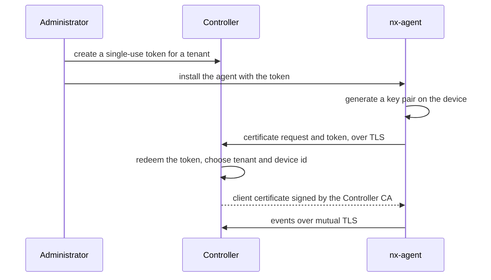

# Identity and tenancy

## How a device proves who it is

A device gets its identity once, at enrolment, and uses it for every later connection.

- The **private key never leaves the device**.
- The token works **once** and expires. A reused, expired or unknown token is refused.
- The Controller takes **only the public key** from the certificate request. The tenant and the device identifier are written by the Controller into the certificate, so nothing in the request can choose them.
- Certificates are short lived and renewed automatically (renewal is planned).

## Tenant isolation

- Every connection uses TLS 1.3 with a client certificate.
- The Controller reads the tenant and the device from the certificate. If an event names a different tenant or device, the whole request is rejected.
- Request size is limited, and requests without a valid certificate are refused.
- The same rule is repeated at each later stage of the pipeline, and a cross-tenant test suite is part of the release criteria.
- An event may carry its own tenant or device field only if it matches the certificate exactly. An empty, null or non-text value counts as a mismatch, and so does a key that differs only in letter case, because some software reads such keys as the same field. Those events are refused.
- The certificate identity must be written in one exact form. Encoded or padded variants of the same name are refused.

### How this is tested

A randomised suite runs six tenants with the same device names in each, through the real API, message bus, stores, policy, updates, revocation and audit log. It mixes honest traffic with events and batches that name other tenants, and checks that nothing crosses a tenant boundary and that every accepted event is stored exactly once. Fuzz tests feed arbitrary request bodies and certificate names to the same code. The suite found two gaps during development (look-alike keys and non-canonical certificate names); both are fixed and kept as regression cases.

## Tenancy tiers

| Tier | Isolation |
|---|---|
| Pooled | Shared services with separate indexes per tenant, document-level security and per-tenant keys |
| Dedicated | A separate namespace or cluster per tenant, provisioned by the Controller |

## People

People sign in with OpenID Connect through an identity service, with one organisation per tenant. Partners who manage several customers use the Nexwall partner portal, which hands the user over to Endpoint with a short-lived signed token.

## Renewal and revocation

Certificates are short-lived. The agent asks for a new one after two thirds of the lifetime has passed and generates a new key for it; the Controller issues it for the same tenant and device only, and not before half of the lifetime has passed. The new certificate is checked against the Controller CA before it replaces the old one.

An administrator can revoke one device or a whole tenant. The Controller checks the revocation list on every request, so a revoked device is refused at once, including when it tries to renew, even while its certificate is still inside its validity period.
