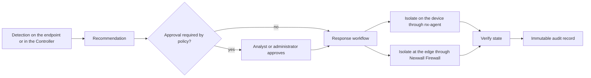

# Response and firewall

The most distinctive part of the design is the loop between the endpoint and the network. When a device is compromised, it can be cut off in two places at once: on the device itself and at the firewall that protects the network.

## Actions

| Action | Where it runs |
|---|---|
| Isolate a device | On the device (host firewall rules) and at Nexwall Firewall |
| Stop a process or quarantine a file | On the device, through the agent |
| Block an indicator (address, domain) | At Nexwall Firewall |
| Collect evidence | On the device, through the agent |

## Properties

- Actions are **requested by the Controller, authorised by policy and idempotent**: running one twice has the same effect as once.
- The agent **confirms the resulting state**, and the audit record is written both on the device and centrally.
- Isolation keeps the channel to the Controller open so the device can be released.
- The design target is to isolate a device at the edge in **under 30 seconds**. It is a target that will be measured over repeated runs before it is claimed.

## Posture-based access

The agent can attest the device's health to produce a short-lived signed token, which the firewall or VPN can require before allowing access to protected resources.
